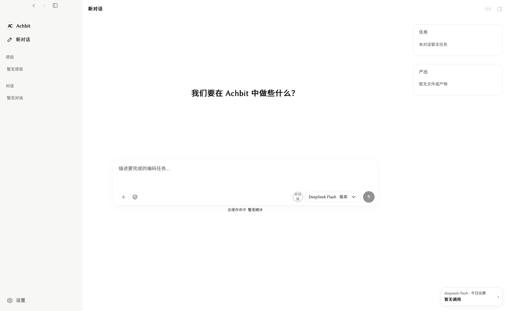
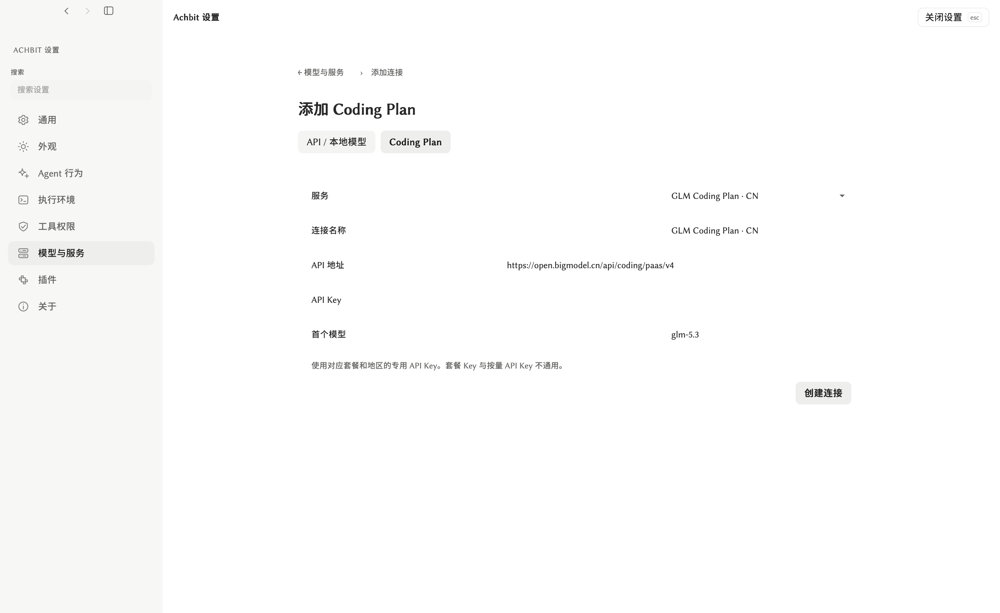

# Achbit

Achbit is a local-first coding agent with a desktop GUI, TUI, and CLI. Read and edit projects, run tools, inspect results, and continue in shared conversations. Connect your preferred model service and extend the agent with Skills, CLI tools, and MCP.

**Achbit** uses an **AC** monogram, recalling “Accepted” in programming contests. See [model services](docs/product/model-services.md) for API and Coding Plan setup.

**[Quick start](#quick-start) · [Download](https://github.com/Achbite/DeepCode/releases) · [DeepSeek guide](docs/product/deepseek.md) · [简体中文](README.zh-CN.md)**

## See it in use



*Current Achbit GUI, captured from the isolated macOS Debug build on 2026-10-23.*



*The model settings preserve the shared interface style and separate API keys from account login. This Chinese-language capture shows a GLM Coding Plan form; it does not demonstrate a live provider request.*

**Real task:** DeepSeek API researches a public page, builds an interactive checklist and verifies it with Computer Use. [See the walkthrough and more examples →](examples/README.md)

## Quick start

### Download and run

Choose a package for your platform from [Releases](https://github.com/Achbite/DeepCode/releases). Each release lists its available packages and platform verification; if your platform has no download, use the source build below.

| Platform | Install or launch |
| --- | --- |
| macOS Apple Silicon | Install `Achbit-<version>-macos-arm64.pkg`, then open `/Applications/Achbit.app`. For the portable archive, open `Achbit.app` inside the extracted directory. |
| Windows x64 | Run `Achbit-<version>-win64-setup.exe` and open Achbit from the Start menu, or open `Achbit.exe` in the portable package. |
| Linux x64 / ARM64 | Extract the matching package and run `./Achbit`. |

1. Open **Settings → Models & services** and configure an API connection or a supported Coding Plan.
2. Select a project folder and a model. For DeepSeek, follow the [English](docs/product/deepseek.md) or [简体中文](docs/product/deepseek.zh-CN.md) guide.
3. Send your first task: **“Read this project's README, explain its purpose and entry points, and cite the files you read.”** Review any access requests and continue in the same conversation.

Packages include their runtime. Windows portable packages need WebView2; Linux GUI needs GTK/WebKitGTK. See [installation, platform requirements, and user files](docs/distribution.md).

### Build from source

Install Docker and GNU Make. On Windows, use WSL2 with Docker integration. For macOS packaging, also prepare Xcode Command Line Tools, the Rust toolchain in `rust-toolchain.toml`, and Node.js on the Mac host.

**On the host:**

```bash
git clone --branch main https://github.com/Achbite/DeepCode.git Achbit
cd Achbit

# macOS only: prepare your persistent local signing identity once,
# before packaging. Follow any Keychain confirmation shown by macOS.
bash scripts/setup-macos-signing.sh

make shell
```

Skip the signing command on Windows and Linux. `main` contains the stable source; `dev-main` tracks development. `make shell` builds or updates the development image, creates or reuses the container for this checkout, and enters its shell. On macOS, it also starts this checkout's native build bridge.

**Inside the container (`/workspace`):**

For daily development, run `bash ./build.sh` (or `pnpm build`). It compiles and updates the development host's complete runnable product in `bin/`, including current native programs, Session code and GUI resources, without creating archives or installers. On macOS, open `bin/macos-arm64/Achbit.app` after the build. Docker uses the host platform supplied by `make shell`; Windows/WSL selects `bin/win64`, and Linux selects its container architecture. To build and package every available platform, explicitly run `bash ./build.sh --stage package` (or `pnpm package`). Select a single distribution package below:

| Target | Command | Output in the checkout |
| --- | --- | --- |
| macOS Apple Silicon | `bash ./build.sh --stage package-macos` | `bin/macos-arm64/` |
| Windows x64 | `bash ./build.sh --stage package-windows` | `bin/win64/` |
| Linux, matching the container architecture | `bash ./build.sh --stage package-linux` | `bin/linux-x64/` or `bin/linux-arm64/` |

Shared TypeScript, GUI resources, Linux programs, and Windows cross-compilation run in Docker. macOS native compilation and signing run on the Mac through the build bridge. Packaging also creates versioned archives in `bin/`, plus a macOS PKG or Windows Setup where applicable.

After a successful runtime build or packaging, run `exit` to leave the container. **Back on the host**, launch your product:

```bash
# macOS
open bin/macos-arm64/Achbit.app
./bin/macos-arm64/Achbit-TUI.command -C /path/to/project

# Linux: use linux-x64 instead if that is the generated architecture
./bin/linux-arm64/Achbit
./bin/linux-arm64/achbit-tui -C /path/to/project
```

On Windows, open the checkout from Windows and launch `bin\win64\Achbit.exe`, or run `bin\win64\achbit-tui.bat -C C:\path\to\project` in a Windows terminal. Continue with the model connection and first task above. The [development guide](docs/development.md) covers build options and updating an existing package.

### Use the terminal

After a macOS PKG or Windows Setup installation, use `achbit-cli` and `achbit-tui` directly; reopen the Windows terminal after installation. Portable packages provide these launchers:

| Platform | CLI | TUI |
| --- | --- | --- |
| macOS | `./Achbit-CLI.command` | `./Achbit-TUI.command` |
| Windows | `.\achbit-cli.bat` | `.\achbit-tui.bat` |
| Linux | `./achbit-cli` | `./achbit-tui` |

```bash
achbit-cli connections
achbit-cli --model <profile-id> chat -C /path/to/project
achbit-tui -C /path/to/project
```

For portable packages, replace the command with its launcher. Copy `<profile-id>` from `connections`; it is a saved configuration ID. In TUI, use `/model` to select a model, `/sessions` and `/resume` to continue a conversation, and `/` for available commands. Use `/language en-US` or `/language zh-CN` to change and save the interface language; this is separate from the language requested in a message. See [terminal and window behavior](docs/distribution.md).

## Models and services

Add API services or supported subscription connections in **Settings → Models & services**. GUI, CLI, and TUI share saved connections and conversations.

See [Models, subscriptions, and usage](docs/product/model-services.md) for connection management and accounting. Provider-specific setup is documented in the [DeepSeek guide](docs/product/deepseek.md).

## Extensions and Computer Use

Add Skills, CLI tools, MCP connections, and UI plugins. The agent discovers registered capabilities by task; tools execute within the configured permissions. See [plugin configuration](docs/product/operations.md#settings-and-extensions) and [UI extensions](docs/product/ui-plugins.md).

In the GUI, use the built-in browser to preview and inspect frontend work. This embedded preview requires a GUI window. When needed and authorized, connect Chrome pages or operate native macOS and Windows applications. Chrome confirms its debugging connection in the browser; native desktop actions follow the platform's permissions. See [Computer Use](plugins/computer-use/README.md) and [Chrome integration](plugins/chrome-devtools/README.md) for supported entries and platforms.

## Development and documentation

Inside `make shell`, run `bash ./test.sh required` for the standard checks, `bash ./test.sh cli` for CLI integration, or `bash ./test.sh full` for the complete registered suite. See [development and validation](docs/development.md) for the environment and scope of each check.

- [Product operations, conversations, and appearance](docs/product/operations.md)
- [Installation, updates, and local data](docs/distribution.md)
- [Workspace environments and permissions](docs/product/execution-environments.md)
- [Models, subscriptions, and usage](docs/product/model-services.md)
- [Release notes and downloads](https://github.com/Achbite/DeepCode/releases)

Workspace files and conversation data stay on your machine. Selected prompts, context, and images are sent to your configured model service; connected tools may communicate with their services. A local model connection keeps model requests on your machine.

## License

[MIT](LICENSE). See [attributions](ATTRIBUTION.md), [third-party notices](THIRD_PARTY_NOTICES.md), and [citation metadata](CITATION.cff).
