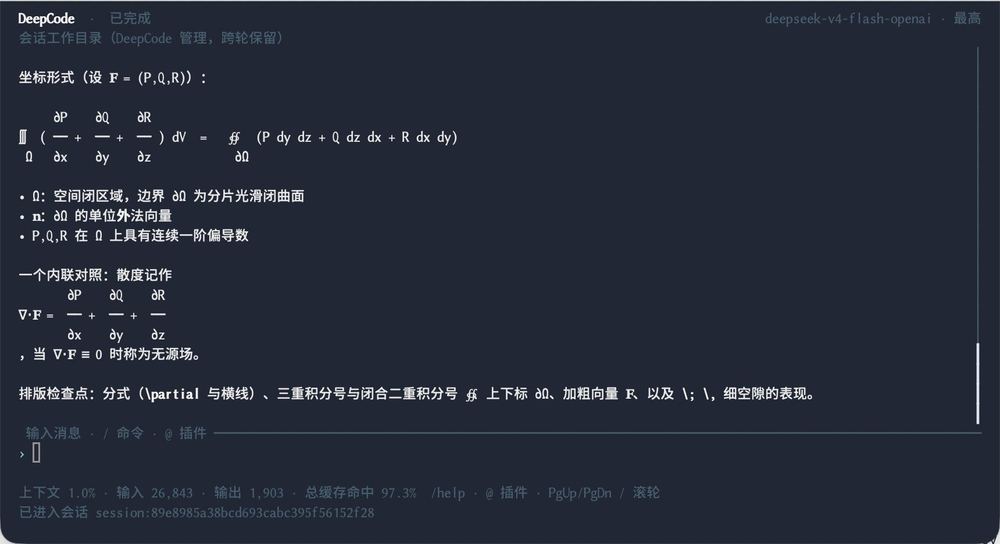

# DeepCode

DeepCode 是提供 GUI、TUI 和 CLI 的本地优先编程 Agent。它可以读取和修改项目、运行工具、检查结果，并在共享会话中继续工作；支持多种模型连接，以及 Skill、CLI 和 MCP 扩展。

**[快速开始](#快速开始) · [下载](https://github.com/Achbite/DeepCode/releases) · [DeepSeek 接入](docs/product/deepseek.zh-CN.md) · [English](README.md)**

## 快速开始

### 下载并运行

在 [Releases](https://github.com/Achbite/DeepCode/releases) 选择对应平台的程序包。每个 Release 会列出实际提供的下载和平台验证情况；没有对应下载的平台可按下方步骤从源码构建。

| 平台 | 安装或启动 |
| --- | --- |
| macOS Apple Silicon | 安装 `DeepCode-<version>-macos-arm64.pkg`，再打开 `/Applications/DeepCode-GUI.app`；解压版直接打开包内的 `DeepCode-GUI.app`。 |
| Windows x64 | 运行 `DeepCode-<version>-win64-setup.exe`，再从开始菜单打开 DeepCode；解压版打开 `DeepCode-GUI.exe`。 |
| Linux x64 / ARM64 | 解压对应架构的程序包，运行 `./DeepCode-GUI`。 |

1. 打开 **设置 → 模型与服务**，配置 API 连接或支持的 Coding Plan。
2. 选择项目文件夹和模型。使用 DeepSeek 时，可直接按照[简体中文](docs/product/deepseek.zh-CN.md)或 [English](docs/product/deepseek.md) 指南配置。
3. 提交第一个任务：**“阅读这个项目的 README，说明项目用途和主要入口，并列出你实际读取的文件。”** 审核出现的访问申请，再在同一会话中继续提问。

程序包包含运行时。Windows 解压版需要 WebView2，Linux GUI 需要 GTK/WebKitGTK。详见[安装、平台要求与用户文件](docs/distribution.md)。

### 从源码构建

先安装 Docker 和 GNU Make。Windows 使用已启用 Docker 集成的 WSL2。打包 macOS 还需要 Mac 宿主机的 Xcode Command Line Tools、`rust-toolchain.toml` 指定的 Rust 工具链和 Node.js。

**在宿主机执行：**

```bash
git clone --branch main https://github.com/Achbite/DeepCode.git
cd DeepCode

# 仅 macOS：打包前一次性准备固定的本地签名身份，
# 按 macOS 提示完成必要的钥匙串确认。
bash scripts/setup-macos-signing.sh

make shell
```

Windows 和 Linux 跳过签名命令。`main` 为稳定源码，`dev-main` 为开发分支。`make shell` 会构建或更新开发镜像、创建或复用挂载当前源码的容器，并进入容器 Shell；macOS 上还会启动当前工作区的原生构建通道。

**在容器内（`/workspace`）执行：**

| 目标平台 | 命令 | 当前源码目录中的输出 |
| --- | --- | --- |
| macOS Apple Silicon | `bash ./build.sh --stage package-macos` | `bin/macos-arm64/` |
| Windows x64 | `bash ./build.sh --stage package-windows` | `bin/win64/` |
| Linux，与容器架构一致 | `bash ./build.sh --stage package-linux` | `bin/linux-x64/` 或 `bin/linux-arm64/` |

共享 TypeScript、GUI 资源、Linux 程序和 Windows 交叉编译在 Docker 中完成；macOS 原生编译与签名经构建通道交给 Mac 宿主机。打包还会在 `bin/` 生成带版本号的压缩包，并为对应平台生成 macOS PKG 或 Windows Setup。

构建成功后执行 `exit` 退出容器，**回到宿主机**启动程序包：

```bash
# macOS
open bin/macos-arm64/DeepCode-GUI.app
./bin/macos-arm64/DeepCode-TUI.command -C /path/to/project

# Linux：如果生成的是 x64 产物，将 linux-arm64 替换为 linux-x64
./bin/linux-arm64/DeepCode-GUI
./bin/linux-arm64/deepcode-tui -C /path/to/project
```

Windows 请从 Windows 打开源码目录，启动 `bin\win64\DeepCode-GUI.exe`；也可在 Windows 终端运行 `bin\win64\deepcode-tui.bat -C C:\path\to\project`。然后按上方步骤连接模型并提交第一个任务。更多构建选项和已有程序包的更新方法见[开发指南](docs/development.md)。

### 在终端中使用

通过 macOS PKG 或 Windows Setup 安装后，可以直接使用 `deepcode-cli` 和 `deepcode-tui`；Windows 安装后需重新打开终端。解压版提供以下启动器：

| 平台 | CLI | TUI |
| --- | --- | --- |
| macOS | `./DeepCode-CLI.command` | `./DeepCode-TUI.command` |
| Windows | `.\deepcode-cli.bat` | `.\deepcode-tui.bat` |
| Linux | `./deepcode-cli` | `./deepcode-tui` |

```bash
deepcode-cli connections
deepcode-cli --model <profile-id> chat -C /path/to/project
deepcode-tui -C /path/to/project
```

解压版请将命令替换为对应启动器。`<profile-id>` 从 `connections` 中复制，是保存的配置 ID。TUI 中用 `/model` 选择模型、`/sessions` 和 `/resume` 继续会话，输入 `/` 查看可用命令。窗口和字体行为见[安装指南](docs/distribution.md)。

## 界面展示


*使用虚构项目数据的真实 GUI 任务：读取 CSV、生成交互式看板并检查预览。可使用[示例 CSV](examples/delivery-dashboard/delivery-data.csv)尝试。这张图片用于通用产品展示。*



*真实 TUI 窗口中的已完成对话，展示当前中文与数学公式排版效果。详见[截图说明](assets/readme/README.md)。*

## 模型与 DeepSeek

在 **设置 → 模型与服务** 中添加 API 服务或支持的订阅连接。GUI、CLI 和 TUI 共享已保存的连接与会话。

DeepSeek 预设使用 **DeepSeek V4.1 Flash**（`deepseek-flash`）和 **Responses API**，上下文配置为 `1000000` token，最大输出预算为 `384000` token。启用 Thinking，并选择、保存 `max` 推理强度。完整的配置、首次任务和继续对话步骤见 [DeepSeek 接入指南](docs/product/deepseek.zh-CN.md)。其他连接及用量口径见[模型、订阅与用量](docs/product/model-services.md)，当前价格以链接的服务商文档为准。

## 扩展与 Computer Use

可以添加 Skill、CLI 工具、MCP 连接和 UI 插件。Agent 按任务发现已登记的能力，工具执行遵循已配置的权限。详见[插件配置](docs/product/operations.md#settings-and-extensions)和 [UI 扩展](docs/product/ui-plugins.md)。

在 GUI 中使用内置浏览器预览和检查前端内容；内嵌预览依赖 GUI 窗口。需要时，可经授权连接 Chrome 页面或操作 macOS、Windows 原生应用。Chrome 调试连接由用户在 Chrome 中确认，原生桌面操作遵循对应系统权限。具体入口和平台能力见 [Computer Use](plugins/computer-use/README.md) 与 [Chrome 接入](plugins/chrome-devtools/README.md)。

## 开发与文档

在 `make shell` 中运行 `bash ./test.sh required` 完成常规检查，`bash ./test.sh cli` 增加 CLI 集成检查，`bash ./test.sh full` 执行完整登记测试。各入口的环境和验证范围见[开发与验证指南](docs/development.md)。

- [产品操作、会话与阅读外观](docs/product/operations.md)
- [安装、更新与本地数据](docs/distribution.md)
- [工作区环境与权限](docs/product/execution-environments.md)
- [模型、订阅与用量](docs/product/model-services.md)
- [版本说明与下载](https://github.com/Achbite/DeepCode/releases)

项目文件和会话数据保存在本机。选中的提示词、上下文和图片会发送给配置的模型服务，接入的工具也可能与各自服务通信。使用本地模型连接时，模型请求留在本机。

## 许可证

[MIT](LICENSE)。另见[来源说明](ATTRIBUTION.md)、[第三方声明](THIRD_PARTY_NOTICES.md)和[引用信息](CITATION.cff)。
