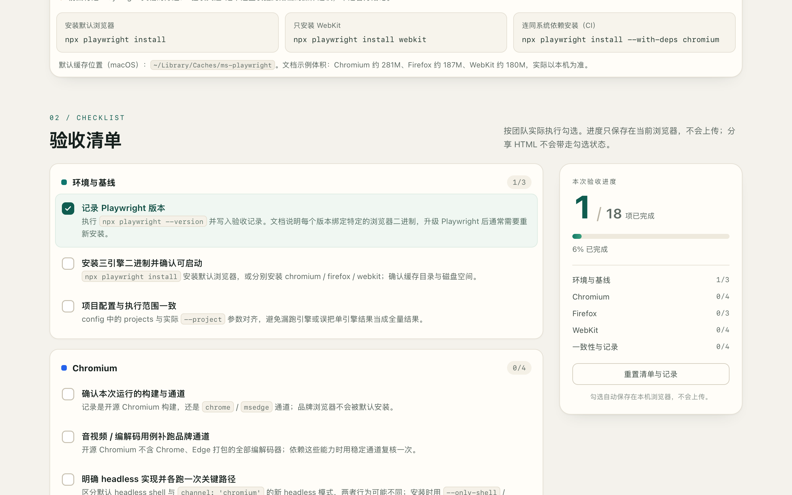

# DeepSeek API: from browser research to a working checklist

[简体中文](README.zh-CN.md) · [All examples](../README.md)

This is a real Achbit task run on 2026-10-23 with **DeepSeek API (`deepseek-flash`)**, using an isolated macOS Debug GUI. The agent read a public website, created a useful local deliverable, and returned to the browser to check its behavior.

## Try the result

- Download [report.html](report.html) and open it in a browser. It is a self-contained Chinese reference page with 18 checklist items in five groups, progress counters, and local persistence.
- [sources.json](sources.json) maps the report's claims to the original documentation and its lookup date.
- [report-checked.png](report-checked.png) is the actual captured result, without visual retouching.
- [run-summary.json](run-summary.json) records the real model, completion, usage and tool outcomes.

The HTML, source ledger and screenshot are copied unchanged from the agent's output. Checking an item in your own browser starts your own local checklist state.

## What happened

1. In the Achbit GUI, the task used the Computer Use plugin to open the [official Playwright browser documentation](https://playwright.dev/docs/browsers), inspect its text and view the Firefox/WebKit sections.
2. DeepSeek wrote `report.html` and `sources.json`, then checked their structure with local commands.
3. It opened the generated HTML in Achbit's browser, clicked the first checklist item, inspected the visual result and reloaded the page. The total changed from **0/18 to 1/18**, the group showed **1/3**, and the progress indicator showed **6%**. The selected state survived reload.
4. Achbit returned the three files as artifacts in the same conversation. The Session recorded `completed` after about **5 minutes 16 seconds**; this is one observed run, not a performance guarantee.

The example demonstrates one connected workflow: public-page observation → local implementation → browser interaction → visual evidence → deliverable files. The model used Achbit's actual tools and shared conversation throughout.

## Reproduce it

Configure a DeepSeek API connection using the [setup guide](../../docs/product/deepseek.md), open a new GUI conversation and paste the [original task prompt](prompt.zh-CN.txt). Keep the built-in Computer Use plugin available. The task needs public network access and permission to write its local output; no additional packages or servers were installed for this run.

## Scope of the evidence

The checked item was an interaction test, **not a completed browser-compatibility acceptance item**. No Chromium, Firefox or WebKit test suite was installed or run. The visible layout was checked at 1280 × 800; narrow screens and external native applications were not tested.

The run also retained three failed browser operations: initial navigation was still loading, a local file URL was rejected by URL navigation, and a direct click targeted a covered input. The agent continued from the returned state using supported operations. These failures remain in the run summary; the final result does not imply that every call succeeded.

Documentation excerpts and translated summaries are attributed to Microsoft and Playwright contributors, [Browsers](https://playwright.dev/docs/browsers), under [CC BY 4.0](https://github.com/microsoft/playwright.dev/blob/main/LICENSE). The Chinese adaptation, checklist layout and interactions were generated during this task. No endorsement by Playwright is implied.
