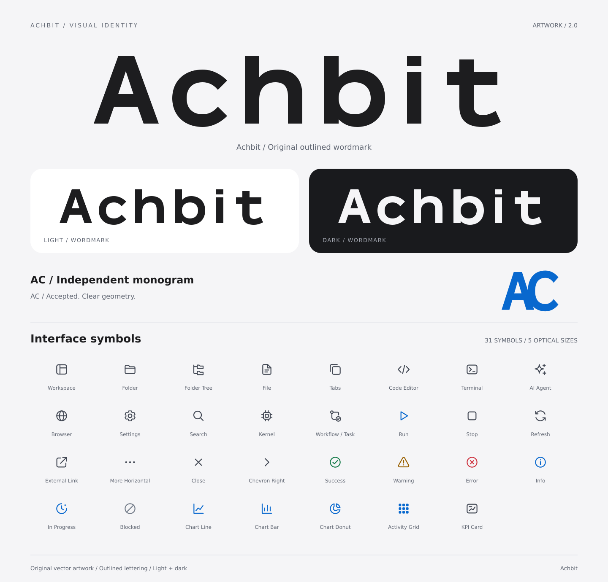

# Achbit brand and interface icons

See the [project README](../../README.md) for the product version and current interface capabilities. This directory holds icon source assets. The consuming UI components own hover, keyboard focus, and vote states.

The original Achbit brand mark, custom path-based wordmark, and 31 interface icons follow Apple Human Interface Guidelines principles for simple outlines, consistency, legibility, and light/dark contexts. All graphics and letterforms are original project artwork.



## Contents

- **Primary brand:** the complete Achbit wordmark, in light, dark, and monochrome variants.
- **Standalone AC mark:** side-by-side A and C joined by curves, with a transparent background.
- **Wordmark:** geometric SVG path lettering drawn for Achbit, without an external font dependency. It is a brand wordmark, not an installable font.
- **Interface icons:** the existing 31 names and paths, with optical sizes of 16 / 20 / 24 / 32 / 64 px.
- **Themes:** currentColor, fixed colors for dark backgrounds, fixed colors for light backgrounds, and transparent PNGs.
- **Previews:** local HTML with theme switching, sizes, category filtering, search, and SVG downloads, plus brand, dark-icon, and optical-size PNG sheets.

## Directory layout

```text
brand/
  masters/                 Original mark and wordmark masters
  svg/                     Light / dark / mono wordmarks and AC marks
  png/                     Transparent wordmark and AC PNGs
sources/
  icons.json               Geometry, semantics, and small-size variants for 31 icons
  preview.html             Preview template
scripts/generate-assets.mjs SVG, PNG, tokens, sprite, manifest, and preview export
svg/
  currentColor/            Inline SVGs inheriting CSS color
  themed/                  Fixed colors for dark backgrounds; existing paths retained
  themed-light/            Fixed colors for light backgrounds
  24/                      24 px currentColor copies; existing paths retained
png/                       Transparent PNGs for dark backgrounds
  light/                   Transparent PNGs for light backgrounds
sprite/achbit-icons.svg    24 px symbols and selected simplified 16 px symbols
tokens/                   Light/dark color and icon-size classes
preview/                  HTML, brand sheet, and dark-icon overview
docs/USAGE.md              Integration, clear space, sizing, export, and references
manifest.json             Asset and master index
```

## Usage

Open the [interactive preview](preview/index.html) and read the [usage guide](docs/USAGE.md).

Inline SVGs and sprites can inherit `currentColor`. SVGs loaded through `` do not inherit the page's color; select the fixed-color variant for the intended theme:

```html


```

## Export again

Edit masters or `sources/`, then run in the project development container mounting this worktree:

```sh
node source/achbit-ui-icon-resources/scripts/generate-assets.mjs
```

PNG export uses `rsvg-convert` (`librsvg2-bin` on Debian). Preview labels use DejaVu Sans; the product wordmark itself needs no font. `--svg-only` updates SVGs and indexes, but perform a complete export before delivery to synchronize PNGs. Do not edit individual generated copies.

Use the full wordmark for primary branding and the standalone AC mark where an abbreviation is needed. Consumers select the appropriate appearance and size.
